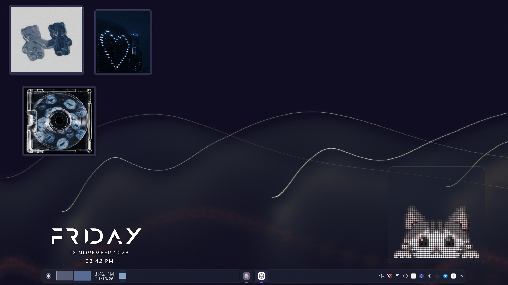

# Cherry red ♡

<p align="center">
  
</p>

<p align="center">
  <b>My personal Arch Linux KDE Plasma rice.</b>
  <br>
  Custom themes, desktop configurations, window decorations, wallpapers and scripts.
</p>

<p align="center">
  
  
  
</p>

---

## ✿ Overview

This repository contains my personal KDE Plasma desktop configuration running on Arch Linux.

Everything is organized to keep the desktop setup reproducible, customizable and easy to restore.

## ✿ Features

- Custom KDE Plasma appearance
- Personalized Plasma desktop theme
- Custom KWin window decorations
- Catppuccin color schemes
- Custom KRunner appearance
- Customized Dolphin and Konsole
- Custom icons and cursors
- Wallpapers and sound themes
- KDE settings and keyboard shortcuts
- Backup and restoration scripts

## ✿ Preview

| Desktop | Applications |
|:---:|:---:|
|  |  |

| KRunner | Konsole |
|:---:|:---:|
|  |  |

*Screenshots will be added as the rice develops.*

## ✿ Repository Structure

```text
arch-rice/
│
├── kde/
│   ├── config/
│   ├── plasma-themes/
│   ├── window-decorations/
│   ├── color-schemes/
│   ├── icons/
│   ├── cursors/
│   ├── kvantum/
│   ├── gtk/
│   ├── konsole/
│   ├── kwin-scripts/
│   ├── widgets/
│   ├── sounds/
│   └── sddm/
│
├── wallpapers/
│   ├── desktop/
│   └── lockscreen/
│
├── packages/
│   ├── pacman.txt
│   └── aur.txt
│
├── scripts/
│   ├── install.sh
│   ├── backup.sh
│   └── restore.sh
│
├── screenshots/
│   ├── desktop/
│   ├── applications/
│   ├── krunner/
│   └── konsole/
│
├── docs/
│
├── README.md
├── LICENSE
└── .gitignore
```

## ✿ Requirements

- Arch Linux
- KDE Plasma
- Bash
- Pacman
- An AUR helper (only if installing AUR packages)
